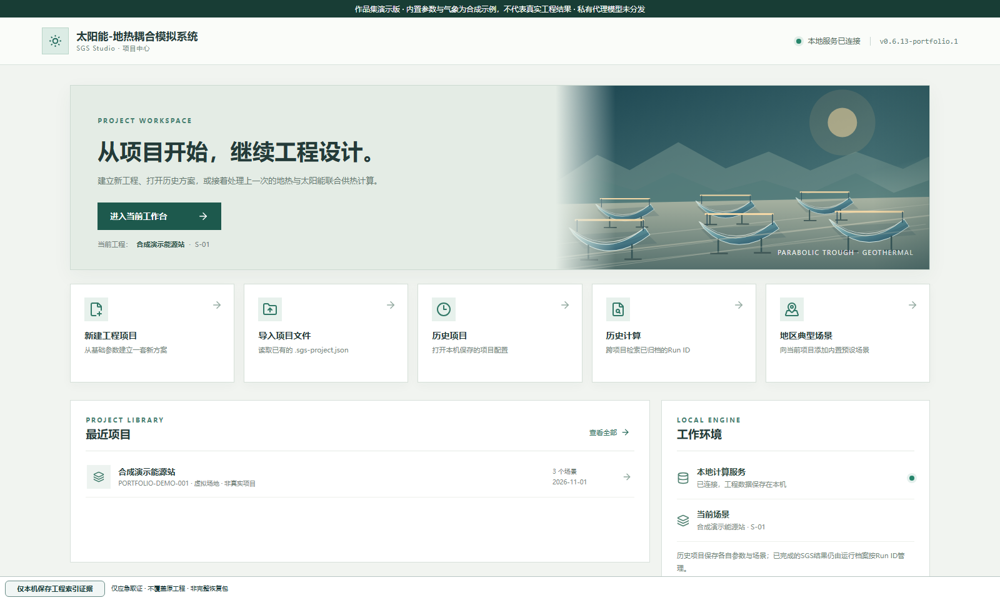
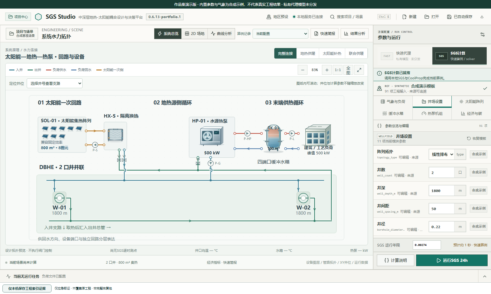

# SGS Studio · 软件作品集

**太阳能—中深层地热耦合设计与计算工作台。** 由作者主导软件研发，将数值求解器、工程参数配置、井场与回路可视化、逐时结果和工程记录组织为桌面应用。

本仓库公开软件介绍、界面截图、使用说明和 Windows 软件发行包。**不公开 SGS 求解器或 SGS Studio 的开发源码。**

[下载 Windows x64 作品集版](https://github.com/oliveria0102-blip/sgs-studio-showcase/releases/latest) · [使用说明](QUICKSTART.md) · [公开版范围](RELEASE_SCOPE.md)

## 从项目到计算

在项目中心创建、打开和管理工程，再进入工作台配置井场、太阳能、水箱、热泵与负荷参数。

工作台展示系统回路、井位、设备和参数之间的联系，并支持调用本地 SGS 数值内核获得逐时计算结果。产品使用 Electron、React/TypeScript、Python 服务和 C++ 数值内核；这些框架和第三方组件不计为作者自研成果。

## 作品集版包含什么

- Windows x64 便携软件，解压后运行，无需自行安装 Node.js 或 Python。
- 项目中心、参数编辑、系统拓扑与井场展示。
- SGS 本地计算链路及结果浏览功能。
- 独立的作品集数据目录，不读取已安装正式版的用户工程。
- 明确标注的合成参数和 8760 小时合成气象，仅用于软件体验。

私有代理模型和真实地区项目模板未分发；快速代理入口在本版本禁用。科研源码、论文、专利、训练数据和真实工程记录不在发行包中。

## 验证范围

作品集包进行了实际桌面启动、后端身份与健康检查、项目打开检查，以及同一生产前端的截图检查。已打包数值内核在合成输入下完成一次 24 小时软件调用测试，返回 24 条逐时记录。该测试证明打包调用链可用，**不构成长期数值验证、实测对比或真实工程设计结论**。

截图来自本发行版的生产前端和真实本地后端，在无头 Chromium 中渲染；隐藏 Electron 窗口的启动和交互另行核验。截图仅含合成项目。

软件为作品集体验发行版，尚未进行新的干净机器安装矩阵测试。版本、SHA-256 和下载文件以 Releases 为准。
